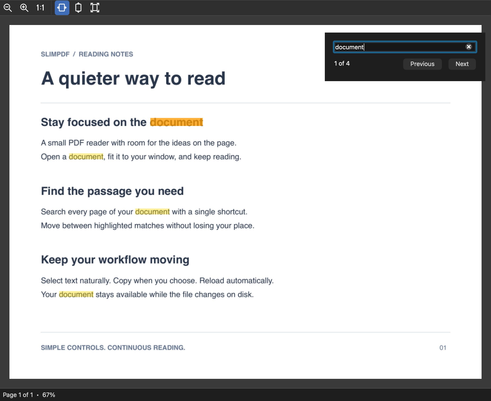

# SlimPDF

A small desktop PDF reader for macOS, Windows and Linux. Read continuously, select and search text, and keep the document open while its file changes on disk.

[Installation](#installation) · [Usage](#usage) · [Build from source](#build-from-source) · [Build packages](#build-packages) · [Tests](#tests)



## Features

- **Continuous reading.** Scroll through pages with a page-aware status bar. A page occupying at least 90% of the viewport is shown alone; otherwise the status shows the visible page range.
- **Text selection.** Drag across lines of text and copy the selection. Selection remains visible after releasing the mouse.
- **Find in document.** Search text with a modeless Find dialog and highlighted matches. Searches ignore case, refresh after reloads and wrap at the document's ends.
- **Zoom and fit.** Zoom from 25% to 400%, reset to 100%, or fit the page's width, height or full area. Fit Width is active by default; fit modes follow window resizing.
- **Automatic reloads.** Refresh changed PDFs while preserving the scroll position. The file is loaded into memory and closed, so it can be renamed or replaced while open.
- **Recent files.** Reopen documents from **File → Open Recent**. macOS also offers recent documents from the Dock menu.
- **Flexible opening.** Use the File menu, drop a PDF onto the window, or pass its path on the command line.

Text selection and search use the PDF's existing text layer. Image-only scans need a text layer before their text can be selected or searched.

## Installation

Download an installer from a successful run of the [**Installation packages** workflow](https://github.com/tsengf/slimpdf/actions/workflows/packages.yml). Extract the downloaded GitHub Actions artifact to access the package.

| Platform | Artifact | Package | Install |
| --- | --- | --- | --- |
| macOS, Apple Silicon / Intel | `slimpdf-macos-universal` | `.dmg` | Open the image and drag **SlimPDF.app** to Applications. |
| Windows x64 | `slimpdf-windows-x64` | `.exe` | Run the installer; it adds a Start menu shortcut and an uninstaller. |
| Ubuntu 24.04 x64 | `slimpdf-linux-deb-x64` | `.deb` | Run `sudo apt install ./slimpdf_*.deb`. |
| Fedora 43 x64 | `slimpdf-linux-rpm-x64` | `.rpm` | Run `sudo dnf install ./slimpdf-*.rpm`. |

macOS and Windows packages include the Qt runtime. Linux packages use the distribution's Qt packages; the package manager installs the required dependencies. Build Linux packages on the distribution and release they target.

macOS packages are ad-hoc signed without Apple notarization. Windows installers are unsigned. The operating system may show an unverified-app warning.

For a portable installation on macOS or Windows, [build a ZIP](#portable-zips) and extract the complete package into a permanent folder.

## Usage

### Quick start

1. Open SlimPDF and choose **File → Open…**, drop a PDF onto the window, or choose a recent file.
2. Scroll through the document. Drag to select text and use **Edit → Copy** or the copy shortcut.
3. Choose **Edit → Find…** to search. Use Enter/Shift+Enter or Find Next/Previous to move between matches; Escape closes Find and clears its highlights.

Launching without a file opens an empty reader window. Opening another PDF replaces the document in that window.

### Reading and document updates

Use the toolbar or **View** menu to zoom or fit the page. Clicking an active fit button turns that mode off while keeping the current zoom. Manual zoom also turns off the fit mode.

Automatic reload watches the original file path. Renaming or moving a file keeps its loaded contents available, but reopen it at the new path to resume automatic updates.

On macOS, recent-file history follows the system's recent-document limit, including zero. Windows and Linux retain up to ten files. Choose **Help → About SlimPDF…** for the version and repository link; on macOS, use **About SlimPDF…** in the application menu.

### Keyboard and mouse controls

| Action | macOS | Linux / Windows |
| --- | --- | --- |
| Open a file | ⌘O | Ctrl+O |
| Zoom in | ⌘+ | Ctrl++ |
| Zoom out | ⌘− | Ctrl+− |
| Reset zoom to 100% | ⌘0 | Ctrl+0 |
| Zoom with the mouse wheel | ⌘ + scroll | Ctrl + scroll |
| Select text | Drag over text, then release | Drag over text, then release |
| Copy selected text | ⌘C | Ctrl+C |
| Find text | ⌘F | Ctrl+F |
| Next match | ⌘G or Enter in Find | F3 or Enter in Find |
| Previous match | ⇧⌘G or Shift+Enter in Find | Shift+F3 or Shift+Enter in Find |
| Close Find | Escape | Escape |

### Launch from the command line

On macOS, open a PDF using a source build:

```bash
./build/SlimPDF.app/Contents/MacOS/SlimPDF document.pdf
```

On Linux:

```bash
./build/slimpdf document.pdf
```

Omit the file argument to open an empty window. On Windows, the executable is `slimpdf.exe`; source builds using Visual Studio normally place it under `build/Release/`.

## Build from source

### Requirements

- Git and CMake 3.19 or later.
- A C++17 compiler.
- Qt 6.4 or later with Core, Gui, Widgets, Pdf and Svg.
- Qt Test for the test suite, enabled by default.
- On macOS, Xcode command-line tools with Objective-C++ and the AppKit SDK.
- On Windows, a compiler and Qt installation with matching architecture and toolchain, such as an MSVC Qt build for Visual Studio.

### Configure and build

Clone the repository and enter its directory:

```bash
git clone https://github.com/tsengf/slimpdf.git
cd slimpdf
```

After installing Qt, configure and build:

```bash
cmake -S . -B build -DCMAKE_BUILD_TYPE=Release
cmake --build build --config Release --parallel
```

If CMake cannot find Qt, add `-DCMAKE_PREFIX_PATH=/path/to/qt`. Use a Qt installation containing all required modules, including Pdf and Svg.

The application is `build/SlimPDF.app` on macOS, `build/slimpdf` on Linux or `slimpdf.exe` on Windows. Multi-configuration generators may add a directory such as `Release`.

### macOS dependencies

For a MacPorts Qt installation, configure with its Qt prefix:

```bash
cmake -S . -B build -DCMAKE_BUILD_TYPE=Release \
    -DCMAKE_PREFIX_PATH=/opt/local/libexec/qt6
cmake --build build --config Release --parallel
```

Use separate build directories when switching Qt installations so cached dependency paths do not carry over.

### Windows dependencies

Choose a Qt installation matching your compiler and target architecture. For a Visual Studio x64 build, run in PowerShell and replace the example Qt path:

```powershell
cmake -S . -B build -A x64 -DCMAKE_PREFIX_PATH=C:/Qt/6.8.3/msvc2022_64
cmake --build build --config Release --parallel
```

Windows packaging is enabled by default and requires Qt 6.7 or later for runtime deployment. For a development build with an older supported Qt version, disable packaging as shown below.

### Build options

| Option | Effect | Default |
| --- | --- | --- |
| `BUILD_TESTING` | Build the test suite; turn off to omit the Qt Test dependency. | `ON` |
| `SLIMPDF_BUILD_PACKAGES` | Enable runtime deployment and the CMake package target. | `ON` |

Add `-DBUILD_TESTING=OFF` to build without tests. Add `-DSLIMPDF_BUILD_PACKAGES=OFF` to disable packaging and deployment, for example when using Qt older than 6.7 on Windows.

## Build packages

Use the configured build for the platform and architecture you want to distribute. Keep the Qt prefix and other dependency options used for that build. CPack stages the installation, deploys Qt on macOS and Windows, and creates the selected package format.

### Native installers

After building and [running the tests](#tests), create an installer:

```bash
cmake --build build --config Release --target package --parallel
```

With the Visual Studio generator, use uppercase `PACKAGE`:

```powershell
cmake --build build --config Release --target PACKAGE --parallel
```

| Platform | Output example | Packaging requirements |
| --- | --- | --- |
| macOS | `build/SlimPDF-1.0.0-macos-arm64.dmg` | Qt deployment tools from the selected Qt installation. |
| Windows x64 | `build/SlimPDF-1.0.0-windows-x64.exe` | Qt 6.7 or later and NSIS 3.03 or later on `PATH`. |
| Debian / Ubuntu | `build/slimpdf_*.deb` | `dpkg-dev` on the target distribution. |
| Fedora | `build/slimpdf-*.rpm` | `rpm-build` on the target distribution. |

The package target builds the app, stages its installation and creates the installer. A normal build does not create a package. Files are written directly to the selected build directory.

macOS DMGs contain the app and an Applications shortcut. Deployment uses `macdeployqt` from the selected Qt installation, includes the Cocoa and SVG plugins, excludes unused SQL drivers, and verifies the app's ad-hoc signature before packaging. It does not notarize the app.

For a universal macOS build, use a universal Qt installation and configure with `'-DCMAKE_OSX_ARCHITECTURES=arm64;x86_64'`. The filename then includes `macos-universal`.

On Linux, configure with `-DCPACK_GENERATOR=DEB` or `-DCPACK_GENERATOR=RPM` to choose one native format. Without a selection, packaging creates both and requires both sets of tools. Linux packages depend on the distribution's Qt runtime packages.

### Portable ZIPs

Choose ZIP output in a separate build directory, including your Qt prefix:

```bash
cmake -S . -B build-zip -DCMAKE_BUILD_TYPE=Release -DCPACK_GENERATOR=ZIP
cmake --build build-zip --config Release --target package --parallel
```

Use uppercase `PACKAGE` with Visual Studio. macOS and Windows ZIPs contain the deployed Qt runtime and do not require NSIS. To create a one-off ZIP from an existing build without changing its configured generator:

```bash
cpack --config build/CPackConfig.cmake -C Release -G ZIP
```

### CI

The [Installation packages workflow](https://github.com/tsengf/slimpdf/actions/workflows/packages.yml) uses the same package target. It runs on pushes to `main`, version tags, pull requests and manual dispatch, builds/tests/packages each platform, and uploads artifacts for 30 days. It does not publish GitHub Releases automatically.

## Tests

After building:

```bash
ctest --test-dir build -C Release --output-on-failure
```

The Qt Test suite renders widgets into images. It runs offscreen on macOS and Linux, and uses the native Windows platform for access to installed fonts. Coverage includes text cursor behavior, live highlights, selection across lines at multiple zoom levels, clipboard preservation, Copy, SVG toolbar rendering, and Find navigation across pages, query changes, reloads and closing the Find dialog.

## Source layout

| Path | Purpose |
| --- | --- |
| `src/main.cpp` | Application startup and command-line file opening. |
| `src/main_window.h`, `src/main_window.cpp` | Rendering, selection, search, zoom, file watching and recent files. |
| `src/macos_dock.h`, `src/macos_dock.mm` | macOS Dock recent-file menu. |
| `src/macos_about.h`, `src/macos_about.mm` | Native macOS About panel. |
| `icons/` | SVG toolbar icons embedded in the app. |
| `tests/text_selection_test.cpp` | Widget and text-interaction regression tests. |
| `CMakeLists.txt` | Application and test build configuration. |
| `cmake/Packaging.cmake`, `cmake/DeployMacOS.cmake` | Installer configuration and macOS deployment. |
| `packaging/linux/slimpdf.desktop` | Linux application menu entry and PDF MIME type. |
| `.github/workflows/packages.yml` | Native builds, tests and installation packages. |

## License

[MIT](LICENSE).
